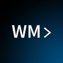

#  ShieldGuard

> A configurable toolkit for Windows software protection and licensing.

ShieldGuard combines PE analysis, configurable protection templates, and Windows executable build workflows in a shared toolkit. Its feature engine selects templates and snippets from a YAML playbook (`Assets/default.yaml`) to build protected, license-checked executables.

It ships with two interfaces over the same core:

* a **Win32 GUI** (Windows Forms) — desktop app with buttons and dropdowns
* a **CLI** with an interactive shell for scripting and automation

No web interface. No WinUI.

---

## What it does

You provide a target PE and a license stub (`.bin` payload). You select protection options (code-cave injection, anti-debug, anti-sandbox, license guardrails, section packing, etc.) and press build. Out comes a Windows executable that runs your license check inside a PE code cave and is hardened against reverse engineering.

The "licensecave" mode injects a license payload into an existing PE, with five injection methods to choose from (code cave, new section, section extension, text padding, TLS callback).

Need to study a Windows binary before protecting it? The `analyze` command gives you a tour of its headers, sections, imports, and code caves.

That's the whole pitch.

---

## Why you might like it

* **Configurable feature engine.** Templates and snippets are defined in `Assets/default.yaml`, providing one place to review and configure protection options.
* **LLVM obfuscation.** Bundled LLVM passes harden the generated binary against reverse engineering by crackers.
* **Tool provisioning.** The application can download MinGW when no compiler is available. The `provision` command downloads missing `bin2license` and `POLY` helpers.
* **It tests itself.** Run `Testing\run_tests.ps1` to cycle through encoders, snippet permutations, and license stubs.

---

## Quick start

```powershell
# Build it
.\build.ps1 -Release

# Launch the Win32 GUI
.\Output\Release\shieldguard.exe

# CLI: download helpers (bin2license, POLY)
.\Output\Release\shieldguard.exe --cli-mode provision

# Inject a license stub into a PE via a code cave
.\Output\Release\shieldguard.exe --cli-mode licensecave --pe target.exe --stub license.bin -o guarded.exe

# Quick PE analysis
.\Output\Release\shieldguard.exe --cli-mode analyze target.exe

# Start the interactive CLI shell
.\Output\Release\shieldguard.exe --cli-mode
```

---

## What you can do with it

| Command | What it does |
|---|---|
| `encode` | Build a protected loader from a license stub, raw hex, or a hosted payload URL. |
| `analyze` | Inspect a Windows PE (headers, sections, imports, code caves). |
| `licensecave` | Inject a license payload into an existing PE (five injection methods). |
| `strip` | Extract or remove PE sections and overlays. |
| `show` | Browse the playbook: templates, snippets, encoders, compilers. |
| `test` | Run the automated test suite. |
| `doctor` | Check compilers and helper tools are present. |
| `provision` | Download external helpers (bin2license, POLY). |

---

## Project layout

```
shieldguard/
├── Assets/default.yaml           the playbook: protection templates + snippets
├── Assets/llvm-passes/           LLVM obfuscation passes
├── ShieldGuard.Core/             the protection engine (shared library)
├── ShieldGuard.Cli/              the CLI command host
├── Testing/                      stubs, injectables, test scripts
├── Output/                       build artefacts (gitignored)
└── shieldguard.exe               Win32 GUI (double-click) or CLI (--cli-mode)
```

---

## License

See the repository for license details. Use ShieldGuard and any generated files only on software you own or are authorized to protect.
